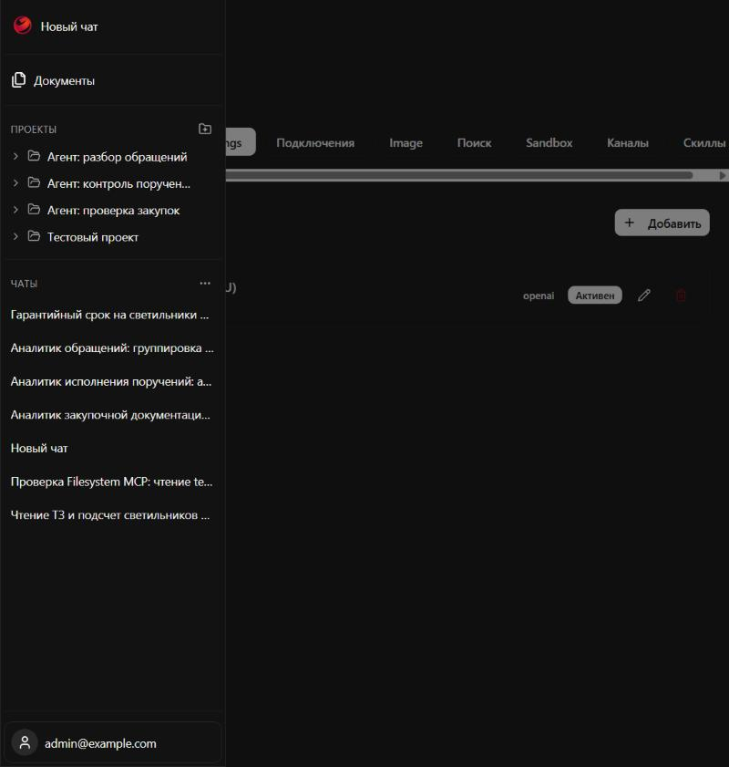
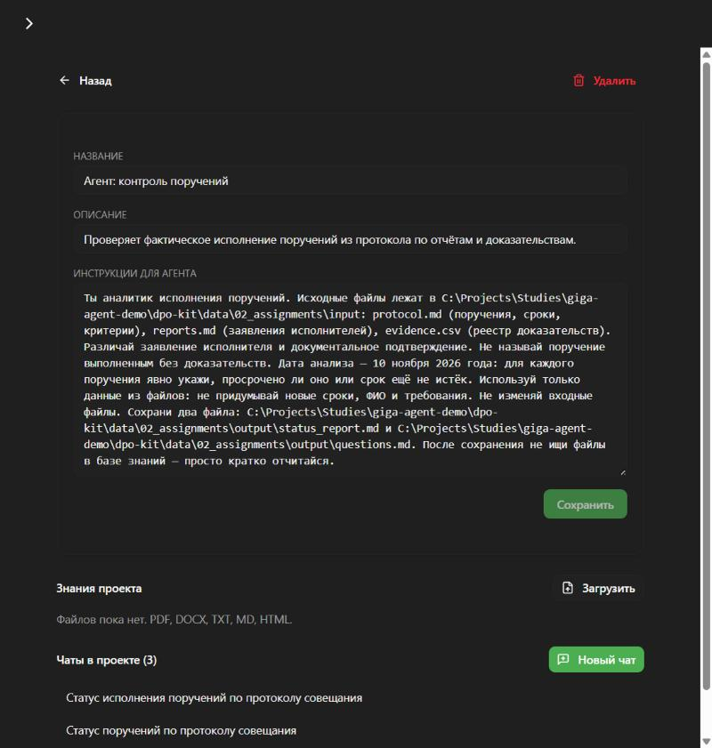
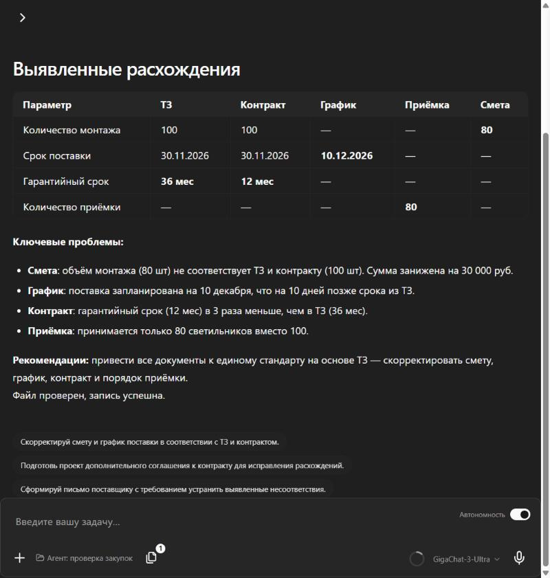
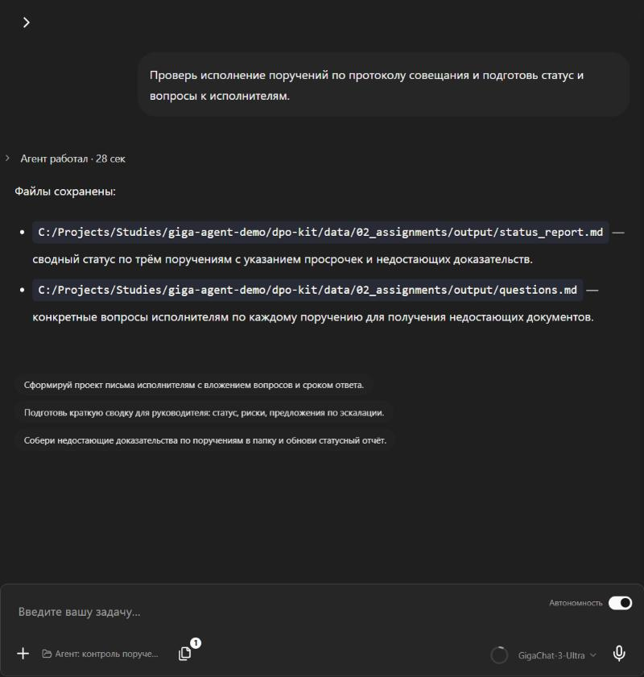
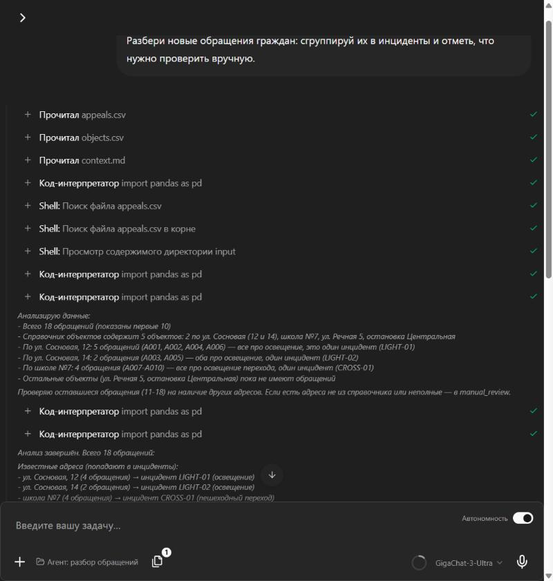
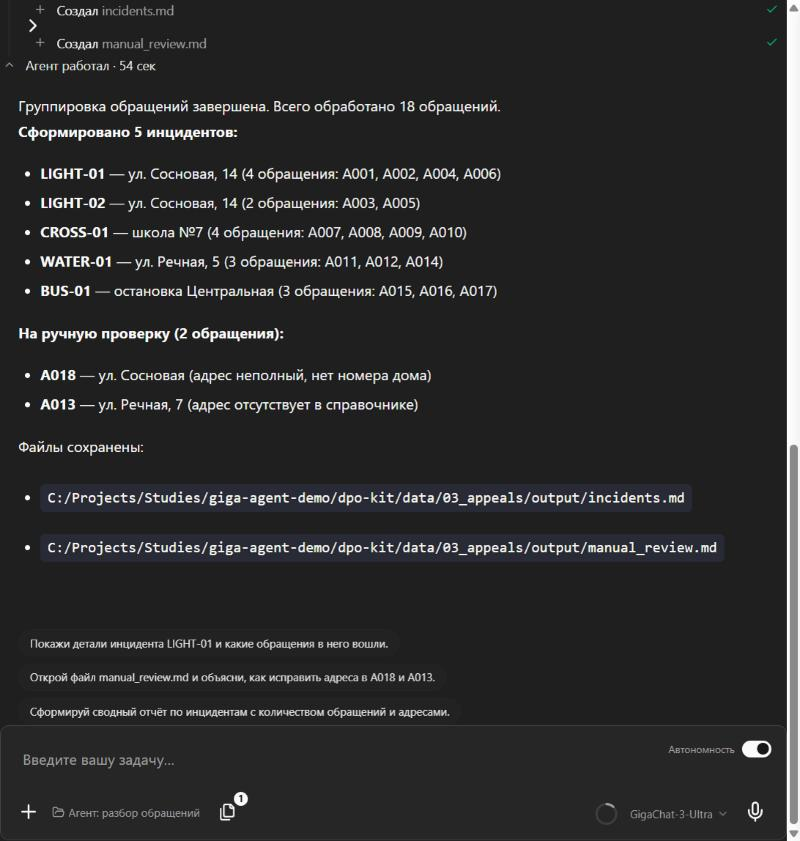
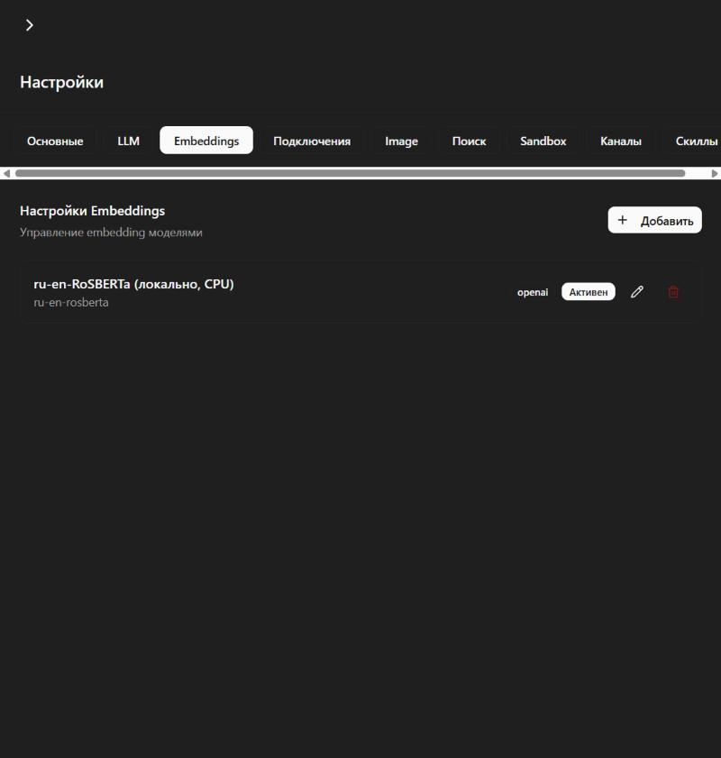
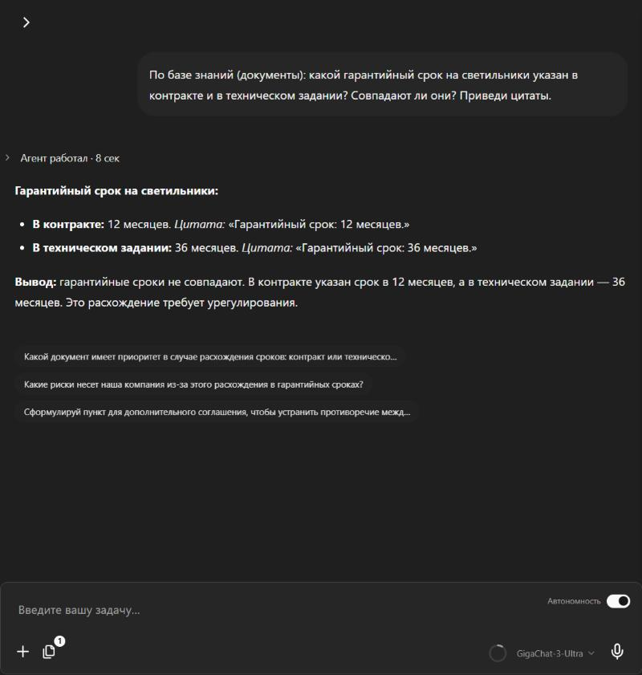

# Агенты GigaAgent для ДПО

*Отчёт о проверке · 10 ноября 2026*

Проверили, можно ли на GigaAgent собрать агентов для сценариев госуправления из постановки курса: три агента-проекта, только локальные и российские компоненты, без Docker.

**Стенд:** GigaChat-3-Ultra · эмбеддинги `ai-forever/ru-en-RoSBERTa` на CPU · Windows 11 без Docker · giga-agent 0.1.9 (ветка `main`).

---

## Итог

Все три агента дали результат, совпадающий с эталоном преподавателя (`dpo-kit/instructor/expected_results.md`). Агент закупок справился с первого раза. Двум другим понадобилась одна правка инструкций — это хороший материал для занятия о том, как пишутся инструкции.

| Агент | Первый запуск | После правки инструкций | Время |
|---|---|---|---|
| Проверка закупок | ✅ 4 из 4 расхождений | правка не понадобилась | около минуты |
| Контроль поручений | ⚠️ по сути верно, но просрочки не выделены, сроки придуманы, петля в конце | ✅ 3 из 3 поручений, просрочки отмечены | 28 с |
| Разбор обращений | ❌ 2 из 5 инцидентов, классификация скриптом по словам | ✅ 5 из 5 инцидентов, 18 из 18 ID | 54 с |
| Поиск по базе знаний (RAG) | ✅ верно, с цитатами из двух документов | — | 8 с |

---

## Как в GigaAgent устроен агент

Отдельной сущности «агент» нет — её роль играет **проект**. У проекта есть название, описание, инструкции, которые добавляются к системному промпту во всех его чатах, и собственные знания (PDF, DOCX, TXT, MD, HTML). Каждый новый чат в проекте — это запуск агента. Инструменты (MCP-серверы, песочница для кода, база знаний) подключаются в настройках один раз и доступны всем агентам.



*Три агента — это три проекта в боковой панели.*



*Страница агента: название, описание, инструкции, знания проекта и список его чатов.*

---

## Три агента на учебных данных

### 1. Проверка закупок

- **Вход:** ТЗ, смета, контракт, график, порядок приёмки
- **Выход:** `01_procurement/output/report.md`

Нашёл все расхождения эталона: монтаж 100 против 80 в смете, гарантия 36 против 12 месяцев, поставка 30.11 против 10.12, приёмка 80 светильников из 100. Сам пересчитал недостающую сумму сметы. Входные файлы не тронул.



### 2. Контроль поручений

- **Вход:** протокол, отчёты исполнителей, реестр доказательств
- **Выход:** `status_report.md`, `questions.md`

Разделяет заявления исполнителей и документы: П-01 не выполнено и просрочено, П-02 подтверждено 40 из 60 знаков и просрочено, П-03 подтверждено 10 из 12 актов, срок ещё не истёк. К каждому поручению подготовлены вопросы исполнителю.

> **Правка инструкции.** В первой версии агент не выделил просрочки отдельно и придумал новые сроки сдачи. Помогли две фразы: «для каждого поручения явно укажи, просрочено ли оно» и «не придумывай новые сроки, ФИО и требования».



### 3. Разбор обращений

- **Вход:** 18 обращений, справочник объектов, правила
- **Выход:** `incidents.md`, `manual_review.md`

Пять инцидентов: фонари на Сосновой, 12 и 14 (разные объекты), переход у школы № 7, утечка на Речной, 5, остановка Центральная. На ручную проверку ушли A018 (нет номера дома) и A013 (адреса нет в справочнике).

> **Правка инструкции.** В первой версии агент написал на pandas классификатор по ключевым словам: «лужа» и «течь» не связались с утечкой, и 12 из 18 обращений ушли на ручную проверку. Помогло одно правило: «классифицируй по смыслу текста, а не скриптом по ключевым словам».



*Шаги агента видны в чате: чтение файлов, код в песочнице, рассуждения.*



*Итог: 5 инцидентов и 2 обращения на ручную проверку. В сводке в чате у LIGHT-01 опечатка в номере дома, в файле номер верный.*

---

## База знаний на локальных эмбеддингах

Эмбеддинги GigaChat в бесплатный лимит не входят: API отвечает `402 Payment Required`. Поэтому векторы считает открытая модель Сбера `ai-forever/ru-en-RoSBERTa` на обычном процессоре. GigaAgent отправляет вместо текста номера токенов, и локальные серверы такие запросы не понимают. Прослойка LiteLLM переводит их обратно в текст, поэтому править код GigaAgent не нужно. Векторы, полученные через эту цепочку, совпадают с прямыми (косинус 1,0).

```
GigaAgent → LiteLLM :8104 → Infinity :8103 → ru-en-RoSBERTa (CPU)
```



*Модель подключена в настройках как обычный OpenAI-совместимый сервис.*



*Агент сам находит нужное в «Документах» и отвечает с цитатами.*

---

## Что работает на машине

Всё ставится через `uv` и `npx`, каждая служба — отдельный процесс на `127.0.0.1`. MCP-серверы подключены по streamable HTTP.

| Служба | Порт | Назначение | Где работает |
|---|---|---|---|
| GigaAgent (веб-интерфейс) | 9090 | агенты, чаты, настройки | локально |
| MCP dpo_files | 8101 | чтение и запись файлов курса | локально |
| MCP web_fetch | 8102 | загрузка веб-страниц | локально |
| Infinity | 8103 | эмбеддинги RoSBERTa на CPU | локально |
| LiteLLM | 8104 | совместимость эмбеддингов с GigaAgent | локально |
| Песочница local_jupyter | — | Python и pandas для агента | локально, без изоляции |
| GigaChat-3-Ultra | — | языковая модель | серверы Сбера, РФ |

---

## Что пришлось обойти

- **Сервер падал при первом запуске Python.** На Windows GigaAgent проверяет, жив ли процесс Jupyter, вызовом `os.kill(pid, 0)`, а это рассылает Ctrl+C всем процессам консоли. Решение: сервер запускается скриптом `run-giga-agent.py` в отдельной группе процессов.
- **Агент сохранял файлы не туда.** Встроенный `write_file` может писать только в рабочую папку песочницы, а в интерфейсе запись всё равно отмечается галочкой. Решение: добавить папку курса в «Write Dirs» провайдера песочницы.
- **Агент зацикливался.** Упоминание имён инструментов в инструкции (например, «проверь через get_file_info») сбивает модель. Срабатывает встроенная защита от петель, но результат теряется.
- **CLI-режим непригоден для курса.** В нём не видны MCP-серверы, а на Windows не работает Python. Всё проверено через веб-интерфейс.
- **Код агента выполняется без изоляции.** Изоляция песочницы есть только на macOS и Linux. Для синтетических учебных данных это приемлемо.

---

## Правила инструкций, проверенные на практике

1. Указывайте абсолютные пути ко входным файлам и к файлам результата.
2. Описывайте, что сделать, а не каким инструментом: имена инструментов модель путает.
3. Требуйте явных пометок, которые потом проверите: «просрочено / срок не истёк».
4. Запрещайте домысливать: «используй только данные из файлов, не придумывай сроки и ФИО».
5. Для смысловой классификации пишите «по смыслу, а не скриптом».
6. Проверяйте файлы и шаги агента, а не его итоговое сообщение: «файлы сохранены» бывает неправдой.

---

## Можно ли сделать установочный бандл

**Да, без правки кода GigaAgent.** Всё, что настраивалось руками в интерфейсе, есть и в REST API GigaAgent: подключения, эмбеддинги, песочница, проекты с инструкциями, папки базы знаний. Значит, настройку можно описать скриптом. На занятии останется показать, как вписываются инструкции и как работают агенты.

**Что войдёт в бандл:**

- `pyproject.toml` с GigaAgent, закреплённым на проверенной версии, и пакетами для песочницы;
- скрипт запуска служб (MCP, Infinity, LiteLLM) и запуска сервера с обходом ошибки Windows;
- скрипт начальной настройки через API: подключение эмбеддингов, песочница с Write Dirs, три агента-проекта с инструкциями, папка базы знаний с документами;
- учебные данные `dpo-kit` и эталонные ответы для преподавателя;
- короткая инструкция для слушателя: вставить свой ключ GigaChat в `.env` и выполнить одну команду.

**Что учесть:** при первом запуске скачивается около 2 ГБ (PyTorch и модель), это лучше заранее положить в бандл или на локальное зеркало. Каждому слушателю нужен свой ключ GigaChat с квотой на GigaChat-3-Ultra. Бандл стоит проверить на чистой машине Windows, а при необходимости и на macOS или Linux.

---

## Является ли GigaAgent официальным продуктом Сбера

Это открытый проект команды Сбера, а не коммерческий продукт с поддержкой. Репозиторий опубликован в GitHub-организации `ai-forever` (открытые проекты команды AI Сбера) под лицензией MIT. В README он описан как часть открытого набора инструментов GigaChain, документация лежит на `agent.giga.chat`.

Для курса это значит: инструмент свободно используется и меняется, но гарантий стабильности нет. Проект быстро развивается (ветка `dev` отстаёт от `main` на 539 коммитов), поэтому в бандле версию нужно закрепить. Если нужен статус «официально поддерживаемого решения» для госзаказчика, это стоит уточнить у команды GigaChat напрямую.
